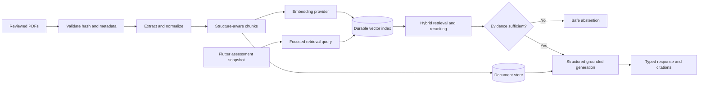

# Pulmora RAG Engine

Evidence-grounded respiratory case review for the Pulmora Flutter application.


Pulmora RAG Engine is a FastAPI backend that receives a validated clinical snapshot, structured findings produced by the mobile app's existing local chest X-ray model, and a doctor's question. It retrieves relevant passages from reviewed respiratory references and returns a structured discussion with traceable citations.

The service does **not** inspect raw X-ray images, replace the local imaging model, diagnose patients, or store the mobile application's visit history.

## What is implemented

- Deterministic PDF ingestion with SHA-256 deduplication and configuration-aware chunk caching.
- SQLite or PostgreSQL document persistence.
- Durable SQLite vector storage and PostgreSQL `pgvector` support.
- Semantic, lexical, and hybrid retrieval with reranking and safe abstention.
- Source provenance down to `file_id`, `chunk_id`, section, and physical PDF page.
- Typed mobile case-review contract at `POST /rag/case-review`.
- Generic grounded question endpoint at `POST /rag/generate`.
- Knowledge-base readiness at `GET /knowledge/status`.
- Structured generation through Groq with strict output and citation validation.
- Stable machine-readable errors and request correlation IDs.
- API-key protection and configurable Flutter Web CORS origins.
- Automated corpus evaluation and restart-persistence verification.

## Architecture



The retrieval query uses the doctor's question plus relevant symptoms, background terms, and structured imaging labels. The complete validated snapshot is supplied separately as generation context. Case data and retrieved passages are treated as untrusted content and cannot override system instructions.

## Repository layout

```text
rag_engine/
├── rag_engine/
│   ├── api/                 FastAPI application, routers, schemas, errors
│   ├── components/          Parsers, normalizers, chunkers, stores, generators
│   ├── configs/             Pipeline configuration
│   ├── core/                Interfaces, registry, shared schemas, config loader
│   └── pipeline/            Ingestion, retrieval, and generation orchestration
├── scripts/                 Ingestion, evaluation, and end-to-end verification
├── evaluations/             Grounded evaluation dataset and recorded result
├── examples/                Synthetic mobile request fixture
├── pdfs/                    Local PDFs plus the audited metadata manifest
├── reports/                 Ingestion and end-to-end verification reports
├── tests/                   Unit and API tests
├── MOBILE_INTEGRATION.md    Exact Flutter integration contract
└── start.py                 BotKeep-compatible entry point
```

PDF binaries and local database files are intentionally excluded from Git. The repository keeps only the audited manifest and corpus notes.

## Quick start with SQLite

Python 3.11 or newer is required.

```bash
python -m venv .venv
```

Activate the environment:

```bash
# Linux/macOS
source .venv/bin/activate

# Windows PowerShell
.venv\Scripts\Activate.ps1
```

Install dependencies:

```bash
pip install -r requirements.txt
```

Create `.env` from `.env.example`, then configure a single-process SQLite deployment:

```env
RAG_STORE_PROVIDER=sqlite_store
RAG_DB_DSN=data/pulmora_rag.db
RAG_API_KEY=replace-with-a-long-random-value
GROQ_API_KEY=replace-with-a-groq-api-key
RAG_ENFORCE_SCOPE=true
```

Place the reviewed PDF files in `pdfs/`. Their names and hashes must match `pdfs/sources.json`.

Ingest and index the default-approved corpus:

```bash
python -m scripts.ingest_corpus \
  --pdf-dir pdfs \
  --manifest pdfs/sources.json \
  --db data/pulmora_rag.db \
  --report reports/ingestion_report.json
```

Start the API:

```bash
python start.py
```

Local URLs:

- API: `http://127.0.0.1:8000`
- Swagger UI: `http://127.0.0.1:8000/docs`
- OpenAPI: `http://127.0.0.1:8000/openapi.json`
- Service/database health: `http://127.0.0.1:8000/health`

## Corpus ingestion behavior

The ingestion command:

1. Validates the corpus directory and manifest.
2. Processes documents in deterministic filename order.
3. Verifies each PDF's SHA-256 hash and physical page count.
4. Rejects files with unusable extracted text.
5. Registers raw bytes and verified metadata in the configured document store.
6. Normalizes and chunks approved pages while preserving provenance.
7. Generates embeddings and populates the active vector index.
8. Marks a document ready only when persisted chunk and vector counts agree.
9. Writes a per-document report and exits nonzero when a required document fails.

Re-running unchanged input is idempotent: existing content is deduplicated, matching chunks are reused, and an already complete index is not rebuilt. A parser/chunker configuration change deliberately produces a new configuration fingerprint and triggers re-indexing.

Optional layout-sensitive references are skipped by default. `--include-optional` should only be used after their tables, pathways, and reading order have been reviewed.

## Readiness and health

`GET /health` is public and reports only service/database health. It does not prove that the evidence pipeline can answer questions.

Use authenticated `GET /knowledge/status` before enabling case review. It reports:

- Registered document count.
- Persisted chunk and indexed-vector counts.
- Documents awaiting indexing or in a failed state.
- Per-document index status and safe failure information.
- Active embedding and vector-store configuration.
- Whether generation credentials are configured, without calling the provider.
- The final `retrieval_ready` decision.

Case review returns `INDEX_NOT_READY` until the reference index is complete.

## API overview

Public routes:

- `GET /`
- `GET /health`
- `GET /docs`
- `GET /redoc`
- `GET /openapi.json`

Protected routes require `X-API-Key` when `RAG_API_KEY` is configured:

| Method | Route | Purpose |
| --- | --- | --- |
| `GET` | `/knowledge/status` | Reference and retrieval readiness |
| `GET` | `/documents` | List documents with index status |
| `POST` | `/documents` | Upload and optionally chunk a document |
| `GET` | `/documents/{file_id}` | Inspect document and index counts |
| `DELETE` | `/documents/{file_id}` | Delete document and associated vectors |
| `POST` | `/documents/{file_id}/chunk` | Chunk or re-chunk a document |
| `GET` | `/documents/{file_id}/chunks` | Inspect persisted chunks |
| `POST` | `/documents/{file_id}/index` | Build or retry the document index |
| `POST` | `/retrieval/search` | Search without generation |
| `POST` | `/rag/generate` | Generic grounded reference question |
| `POST` | `/rag/case-review` | Typed Pulmora assessment review |
| `GET` | `/rag/models` | Inspect configured generation models |

The generated OpenAPI document is the source of truth for field constraints and response schemas.

### Generic grounded question

```bash
curl -X POST http://127.0.0.1:8000/rag/generate \
  -H "Content-Type: application/json" \
  -H "X-API-Key: $RAG_API_KEY" \
  -d '{
    "query": "How is hospital-acquired pneumonia defined?",
    "top_k": 3,
    "mode": "hybrid",
    "file_id_filter": null
  }'
```

### Mobile case review

```bash
curl -X POST http://127.0.0.1:8000/rag/case-review \
  -H "Content-Type: application/json" \
  -H "X-API-Key: $RAG_API_KEY" \
  --data @examples/case_review_request.json
```

The case response includes unchanged correlation fields, a case summary, evidence discussion, missing information, review points, abstention state, token usage, and actual retrieved sources. `pdf_page` is the 1-based physical PDF position, not a printed page label. Retrieval scores indicate matching relevance—not diagnostic or medical confidence.

See [MOBILE_INTEGRATION.md](MOBILE_INTEGRATION.md) for the complete Flutter mapping, request/response examples, error handling, stale-response protection, and citation semantics.

## Error contract

Errors retain `detail` for backward compatibility and provide a stable typed body:

```json
{
  "detail": "Reference documents are not fully indexed.",
  "error": {
    "code": "INDEX_NOT_READY",
    "message": "Reference documents are not fully indexed.",
    "request_id": "client-or-server-request-id",
    "retryable": true
  }
}
```

Important codes include:

- `UNAUTHORIZED`
- `VALIDATION_ERROR`
- `PAYLOAD_TOO_LARGE`
- `KNOWLEDGE_BASE_EMPTY`
- `INDEX_NOT_READY`
- `GENERATION_UNAVAILABLE`
- `INVALID_MODEL_RESPONSE`

Clients may supply `X-Request-ID`; it is returned in the response header and typed error body.

## PostgreSQL and pgvector

For PostgreSQL development, start the included service:

```bash
docker compose up -d
```

Then use a PostgreSQL DSN and the default `postgres_store` / `pgvector_store` configuration. The database account must be allowed to create or access the `vector` extension.

Use PostgreSQL for multi-instance deployments. SQLite is supported for one API process and is durable only when its database file lives on storage that survives both restarts and redeployments.
The service creates a missing parent directory for a file-backed SQLite DSN, but the configured location must still be writable by the container user.

## BotKeep deployment

1. Create or update the BotKeep Python application from this repository.
2. Select Python 3.11.
3. Use the repository root containing `requirements.txt`.
4. Set the startup command to:

   ```text
   python start.py
   ```

5. Configure secrets/environment variables:

   ```env
   RAG_API_KEY=<long-random-secret>
   GROQ_API_KEY=<groq-secret>
   RAG_ENFORCE_SCOPE=true
   RAG_MAX_UPLOAD_MB=20
   RAG_LLM_TEMP=0.1
   RAG_LLM_MAX_TOKENS=1024
   ```

6. Choose one durable storage arrangement:

   - PostgreSQL with `pgvector`: set `RAG_DB_DSN` and keep the default providers.
   - Single-instance SQLite: start with `RAG_STORE_PROVIDER=sqlite_store` and `RAG_DB_DSN=data/pulmora_rag.db`. If BotKeep provides a persistent-volume mount, replace it with the exact writable mount path shown by BotKeep—not a documentation placeholder.

7. Do not hard-code a port. BotKeep supplies `SERVER_PORT`.
8. Deploy the code, place the reviewed PDFs on the server without committing them to Git, and run the ingestion command once against the durable store.
9. Verify `/health`, then authenticated `/knowledge/status`, then a synthetic `/rag/case-review` request.

Container-local SQLite and PDF paths must not be assumed to survive a redeploy. A successful `/health` response alone is not deployment verification.

## Configuration

| Variable | Required | Description |
| --- | --- | --- |
| `RAG_API_KEY` | Production | Shared prototype API key for protected routes |
| `GROQ_API_KEY` | Generation | Groq credential; never expose it to Flutter |
| `RAG_DB_DSN` | Yes | PostgreSQL connection string or SQLite file path |
| `RAG_STORE_PROVIDER` | SQLite only | Set to `sqlite_store` for SQLite deployments |
| `RAG_CORS_ORIGINS` | Flutter Web | Comma-separated explicit origins |
| `RAG_DB_POOL_MAX` | PostgreSQL | Maximum connection-pool size |
| `RAG_MAX_UPLOAD_MB` | Optional | Upload limit; default is 20 MB |
| `RAG_LLM_MODEL` | Optional | Preferred Groq model |
| `RAG_LLM_TEMP` | Optional | Generation temperature |
| `RAG_LLM_MAX_TOKENS` | Optional | Generation output limit |
| `RAG_ENFORCE_SCOPE` | Recommended | Restrict retrieval to configured respiratory terms |

Never commit `.env`, API keys, database credentials, patient data, local databases, or copyrighted PDF binaries.

## Verification

Install development dependencies with `uv`:

```bash
uv sync --dev
```

Or with `pip`:

```bash
pip install -r requirements.txt pytest pytest-cov httpx
```

Run the automated test suite:

```bash
python -m pytest -q
```

Evaluate retrieval against the inspected corpus:

```bash
python -m scripts.evaluate_corpus \
  --db data/pulmora_rag.db \
  --dataset evaluations/datasets/pulmora_corpus_eval_v1.json \
  --report evaluations/history/pulmora_corpus_eval_report_v1.json
```

Verify persisted retrieval and a synthetic mobile request after reopening the database:

```bash
python -m scripts.verify_e2e \
  --db data/pulmora_rag.db \
  --fixture examples/case_review_request.json \
  --report reports/e2e_verification.json
```

Latest recorded local engineering result:

- 26 automated tests passed.
- 7 of 7 corpus retrieval checks passed.
- 3 default-approved references ready.
- 1,334 persisted chunks and 1,334 indexed vectors.
- Retrieval succeeded after database reopen.
- Synthetic case correlation and PDF-page citations were verified.

These checks validate the software pipeline, not the clinical correctness of recommendations. Clinical evaluation requires qualified reviewers.

## Supporting documentation

- [Flutter integration contract](MOBILE_INTEGRATION.md)
- [Synthetic case request](examples/case_review_request.json)
- [Corpus metadata manifest](pdfs/sources.json)
- [Arabic corpus notes](pdfs/README_AR.md)
- [Ingestion report](reports/ingestion_report.json)
- [Retrieval evaluation report](evaluations/history/pulmora_corpus_eval_report_v1.json)
- [End-to-end verification report](reports/e2e_verification.json)

## Security and clinical boundaries

- The mobile assessment ID is a correlation identifier, not proof of authorization.
- A shared API key embedded in a public mobile binary can be extracted. Replace it with real user authentication or a trusted backend proxy before public production use.
- Do not send patient names, phone numbers, dates of birth, or raw X-ray images to the case-review endpoint.
- Imaging labels remain model-generated findings and are not confirmed diagnoses.
- Uncalibrated scores are not interpreted as disease probabilities.
- The service abstains when the indexed corpus does not support a question.
- Reference licensing and redistribution rights must be reviewed before production ingestion.

## License

No project license is currently declared. Medical reference documents remain the property of their respective publishers and are not redistributed through this repository.
